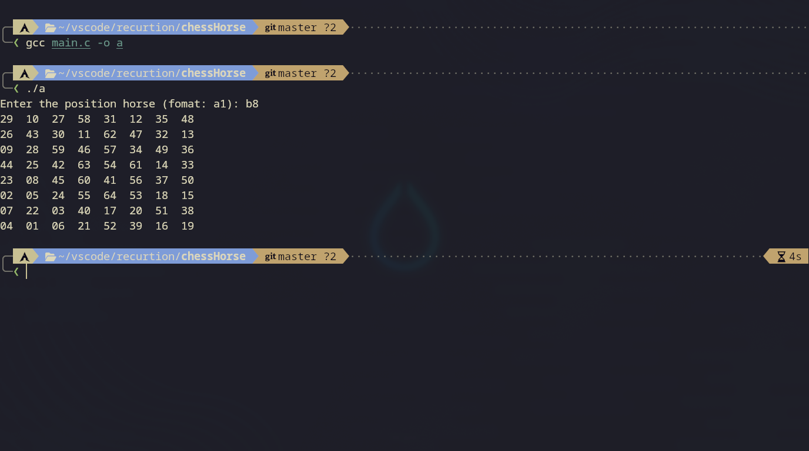

# Knight's Tour Solver

A C implementation of a solver for the Knight's Tour problem on a standard $8 \times 8$ chessboard. The program computes a complete sequence of 64 legal knight moves such that every square on the board is visited exactly once, starting from a user-defined initial coordinate.

## Algorithmic Overview

Rather than relying on naive brute-force backtracking, the solver combines depth-first search (DFS) with **Warnsdorff's heuristic** and a **peripheral tie-breaking rule** to achieve near-linear execution time:

1. **State Representation**: The $8 \times 8$ board is stored as a contiguous 1D array of 64 `short int` elements (`chessBoard[SIZE]`), accessed via row-major indexing (`y * LEN + x`). Unvisited squares hold `0`, while visited squares store their respective step number (`1` to `64`).
2. **Warnsdorff's Rule (Counting Phase)**: At each step, the solver evaluates all 8 potential knight jumps (`walks`). For every valid and unvisited target square, it performs a 1-step lookahead to count the number of onward moves available from that square. Out-of-bounds or already visited squares are assigned a sentinel penalty value (`DOWN_NUM = 10`).
3. **Euclidean/Manhattan Tie-Breaking (Sorting Phase)**: Candidate moves are sorted in ascending order of their onward degree using an in-place bubble sort. When two candidate squares have an identical number of onward moves, the tie is broken by evaluating their scaled Manhattan distance from the geometric center of the board:
   $$D(x, y) = \vert{}2x - (LEN - 1)\vert{} + \vert{}2y - (LEN - 1)\vert{}$$
   Moves positioned further from the center (closer to the edges and corners) are prioritized first, preventing isolated squares late in the tour.
4. **Backtracking (Main Logic)**: The solver iterates through the prioritized move list recursively. If a branch leads to a dead end before reaching step 64, the current square is reset to `0` and the next candidate move is evaluated.

## Example Execution

## Configuration Macros

| Macro | Value | Description |
| :--- | :--- | :--- |
| `SIZE` | `64` | Total number of squares on the chessboard ($8 \times 8$). |
| `LEN` | `8` | Board dimension (number of rows and columns). |
| `COUNT_W` | `8` | Maximum number of possible knight jumps from any given square. |
| `DOWN_NUM` | `10` | Sentinel weight assigned to unreachable or already visited squares. |
| `SWAP(a,b,t)` | Macro | In-place value swap utilizing a temporary variable `t`. |
